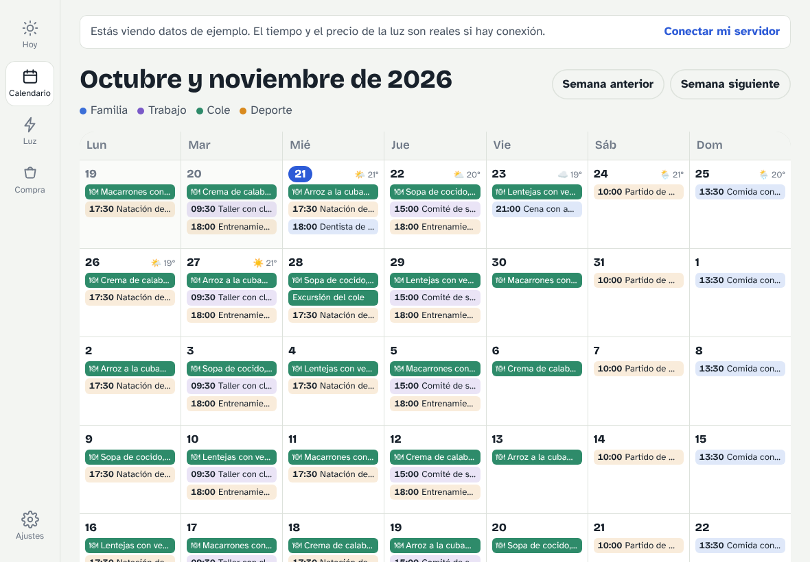
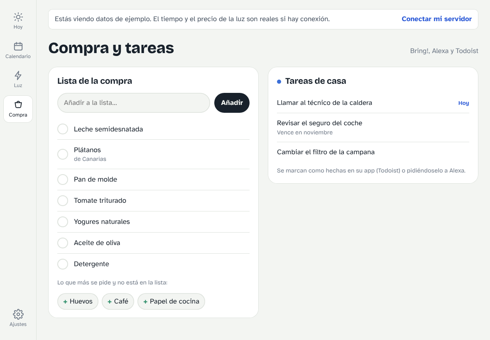
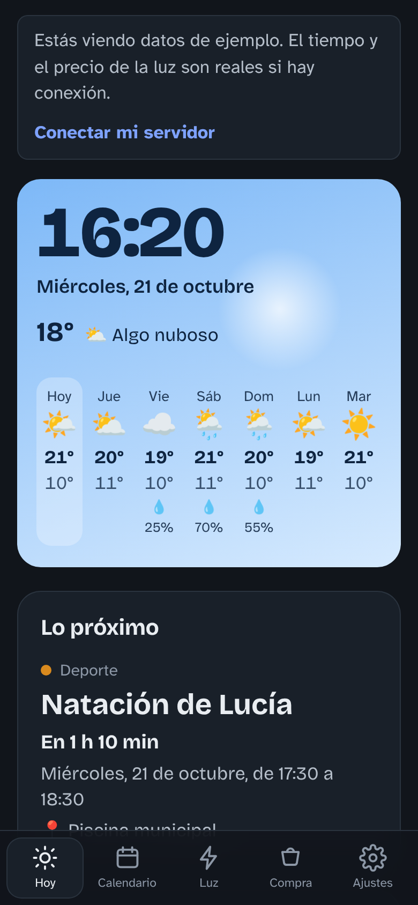
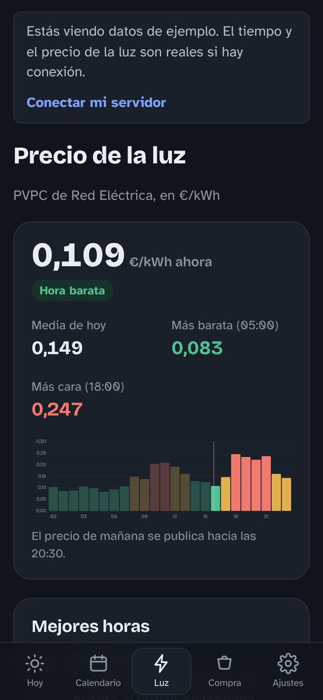

# Casa: panel familiar para iPad y móvil 🏠

Una app para tener **la casa de un vistazo**: el calendario de toda la familia, el **precio de la luz** con las mejores
horas para cargar el coche o poner el lavavajillas (y cuánto se ahorra), y la **lista de la compra** que se llena
desde Bring! o por voz con Alexa. Pensada para un **iPad colgado en la pared**, y también para el iPhone o el Android
de cada uno.

Es una **web app instalable (PWA)**: se abre en Safari y se añade a la pantalla de inicio. **Sin App Store, sin Mac,
sin cuenta de desarrollador y sin ningún coste.** La misma app sirve en iPad, iPhone y Android.

| | |
|---|---|
|  **Hoy** |  **Luz** |
|  **Calendario de pared** |  **Compra y tareas** |

<p align="center"> </p>

> Las capturas usan los datos de ejemplo que trae la app mientras no tiene servidor: nombres y citas inventados.

## Qué hace

- **Hoy:** una franja de cielo que cambia de color con el sol (con la hora, la fecha y el tiempo de 7 días), lo
  próximo en el calendario con cuenta atrás, la semana entera con el menú del cole, el precio de la luz de ahora y lo
  que falta en la compra.
- **Calendario de pared:** cinco semanas de lunes a domingo con el tiempo de cada día. Tocar una cita enseña el
  detalle.
- **Luz:** el PVPC de hoy (y de mañana desde las 20:30) por horas, la hora más barata y la más cara, y para cada
  aparato el mejor tramo y lo que se ahorra frente a ponerlo ahora. Los aparatos y su consumo se cambian en Ajustes.
- **Compra y tareas:** tocar un producto lo tacha (en Bring!, y de ahí en Alexa), se puede deshacer, se añaden
  productos y los habituales están a un toque. Las tareas de casa de Todoist aparecen con su fecha.
- **De noche** se queda en un reloj tenue; funciona **sin conexión** con la última copia y mantiene la pantalla
  encendida.

## Cómo funciona

```
 iPad / iPhone / Android                              Equipo de casa siempre encendido (opcional)
 ───────────────────────                              ───────────────────────────────────────────
 App «Casa» (GitHub Pages) ──── Tailscale (privado) ───▶ servidor/ : API + Home Assistant
   │                                                      ├─ Google Calendar (iCal secreto)
   ├─▶ Open-Meteo (tiempo, directo)                       ├─ Bring!, Todoist, Alexa (compra y tareas)
   └─▶ Red Eléctrica (precio de la luz, directo)          └─ Red Eléctrica (por si el navegador no llega)
```

- **Sin servidor** la app ya enseña el tiempo y el precio de la luz reales, con calendario y compra de ejemplo.
- **Con el servidor** (en una Raspberry Pi, un PC viejo o un mini PC) aparecen tus calendarios y tu lista de la
  compra. Los secretos (direcciones iCal, tokens) viven solo en el servidor; nada se abre a Internet: el iPad llega
  por la red privada de Tailscale. Guía completa: [`servidor/README.md`](servidor/README.md).

## Puesta en marcha

### 1. Publicar la app (una vez)

En este repositorio de GitHub: **Settings → Pages → Build and deployment → Source: GitHub Actions**. El flujo
[`.github/workflows/pages.yml`](.github/workflows/pages.yml) publica la carpeta `app/` en cada cambio. La app queda en:

**https://mmonge7.github.io/DashboardFamiliar/**

### 2. Instalarla en el iPad o el iPhone

1. Abre esa dirección en **Safari**.
2. Toca **Compartir → Añadir a pantalla de inicio**. Se abre a pantalla completa, con su icono, como cualquier app.
3. En **Ajustes** (dentro de la app) elige tu municipio para el tiempo y ajusta los aparatos de «mejores horas».

En Android: Chrome → menú → **Instalar aplicación**.

### 3. El iPad como panel de pared

- **Acceso Guiado:** Ajustes del iPad → Accesibilidad → Acceso Guiado → activar. Con la app abierta, pulsa tres veces
  el botón lateral (o el de inicio) y empieza: el iPad se queda fijo en la app.
- **Que no se apague:** Ajustes → Pantalla y brillo → Bloqueo automático → Nunca (y deja el iPad cargando).
- La app oscurece la pantalla de noche (horario en Ajustes de la app); tocarla la despierta un minuto.

### 4. Conectar tus datos (opcional)

Monta el servidor siguiendo [`servidor/README.md`](servidor/README.md) y pon su dirección y su token en Ajustes.

## Estructura

```
app/                 La app (HTML, CSS y JavaScript sin compilar; se publica tal cual)
├── index.html, manifest.webmanifest, sw.js   página, instalación y modo sin conexión
├── js/data/         calendario (ical.js), luz (REE), tiempo (Open-Meteo), compra
├── js/views/        Hoy, Calendario, Luz, Compra, Ajustes
├── vendor/          ical.js (MPL-2.0)
└── fonts/           Bricolage Grotesque y Atkinson Hyperlegible (OFL)
servidor/            API, scripts de la compra y despliegue con Docker + Tailscale
docs/capturas/       capturas del README
```

Para probarla en el ordenador: `cd app && python3 -m http.server 8000` y abre `http://localhost:8000`.

## Privacidad

- Nada de la familia está en este repositorio: la configuración real y los secretos están en el servidor, ignorados
  por git (`.gitignore`), y los ajustes de cada dispositivo se guardan solo en ese dispositivo.
- La dirección del servidor y el token se escriben a mano en Ajustes; no van en la app publicada.

## Créditos y licencia

Licencia **MIT**, como el proyecto del que parte. Es una adaptación a web app (iPad, iPhone y Android) de
[**leontdi/marco-familiar-dashboard**](https://github.com/leontdi/marco-familiar-dashboard), que a su vez evoluciona
[**eusonlito/Planify-Dashboard**](https://github.com/eusonlito/Planify-Dashboard), inspirado en
[**wesbos/photo-frame-dashboard**](https://github.com/wesbos/photo-frame-dashboard). Del proyecto de leontdi se
reutilizan la idea de las pantallas, el cálculo de las mejores horas de la luz y los scripts de la compra
(`compra_sync.py`, `compra_export.py`, `familia.py`).

Terceros: [ical.js](https://github.com/kewisch/ical.js) (MPL-2.0, `app/vendor/`), las fuentes Bricolage Grotesque y
Atkinson Hyperlegible (SIL OFL 1.1, `app/fonts/`), [Open-Meteo](https://open-meteo.com) (datos del tiempo, CC BY 4.0),
[Red Eléctrica](https://www.ree.es/es/apidatos) (precio de la luz) y [Home Assistant](https://www.home-assistant.io).
